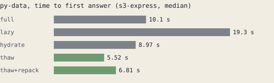
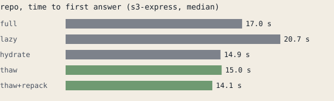
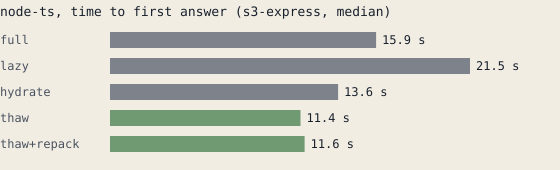

# Results

Generated by `thaw report` from `vm.json` and `sim.json` in this directory. Medians unless marked.

## Real VMs

linux 6.8.0-142-generic, 6 CPUs, 12220172 kB RAM

Firecracker inside a Lima VM (nested virtualization on Apple silicon). Store is a local directory shaped to each profile's latency and bandwidth.

Measured 2026-10-17. 30 training restores, then every strategy on every task of each environment, s3-express and s3-standard.

### Store: s3-express

| env | strategy | time to answer | p90 | task in guest, stalls included | waited on (blocks) | fetched | requests | correct |
|---|---|--:|--:|--:|--:|--:|--:|--:|
| py-data | boot + setup from scratch | 134.0 s | | | | | | |
| py-data | full | 10.1 s | 36.6 s | 3.46 s | 0 | 539.1 MiB | 671 | 10/10 |
| py-data | lazy | 19.3 s | 72.1 s | 18.0 s | 2531 | 53.9 MiB | 2536 | 10/10 |
| py-data | hydrate | 8.97 s | 27.5 s | 7.51 s | 45 | 539.3 MiB | 710 | 10/10 |
| py-data | thaw | 5.52 s | 37.0 s | 5.13 s | 132 | 125.6 MiB | 3662 | 10/10 |
| py-data | thaw+repack | 6.81 s | 82.2 s | 5.98 s | 21 | 118.1 MiB | 86 | 10/10 |
| repo | boot + setup from scratch | 17.2 s | | | | | | |
| repo | full | 17.0 s | 26.2 s | 12.6 s | 0 | 339.7 MiB | 240 | 9/10 |
| repo | lazy | 20.7 s | 33.0 s | 19.4 s | 1606 | 33.7 MiB | 1612 | 10/10 |
| repo | hydrate | 14.9 s | 23.3 s | 12.4 s | 24 | 339.8 MiB | 256 | 10/10 |
| repo | thaw | 15.0 s | 22.2 s | 13.7 s | 133 | 48.4 MiB | 1882 | 10/10 |
| repo | thaw+repack | 14.1 s | 24.6 s | 13.4 s | 120 | 39.0 MiB | 152 | 10/10 |
| node-ts | boot + setup from scratch | 172.9 s | | | | | | |
| node-ts | full | 15.9 s | 26.8 s | 10.8 s | 0 | 374.6 MiB | 176 | 10/10 |
| node-ts | lazy | 21.5 s | 28.4 s | 20.2 s | 3324 | 43.1 MiB | 3330 | 10/10 |
| node-ts | hydrate | 13.6 s | 20.3 s | 10.9 s | 22 | 374.6 MiB | 194 | 10/10 |
| node-ts | thaw | 11.4 s | 15.8 s | 11.0 s | 217 | 75.9 MiB | 3768 | 10/10 |
| node-ts | thaw+repack | 11.6 s | 17.1 s | 10.8 s | 255 | 51.3 MiB | 296 | 10/10 |

### Store: s3-standard

| env | strategy | time to answer | p90 | task in guest, stalls included | waited on (blocks) | fetched | requests | correct |
|---|---|--:|--:|--:|--:|--:|--:|--:|
| py-data | boot + setup from scratch | 134.0 s | | | | | | |
| py-data | full | 14.2 s | 76.3 s | 4.98 s | 0 | 539.1 MiB | 671 | 10/10 |
| py-data | lazy | 99.4 s | 304.2 s | 66.6 s | 2788 | 61.4 MiB | 2793 | 8/10, 2 over the 5 min limit |
| py-data | hydrate | 10.3 s | 40.8 s | 8.51 s | 51 | 539.4 MiB | 718 | 10/10 |
| py-data | thaw | 22.5 s | 207.9 s | 20.5 s | 325 | 125.7 MiB | 3612 | 10/10 |
| py-data | thaw+repack | 6.84 s | 188.3 s | 5.42 s | 21 | 118.1 MiB | 85 | 10/10 |
| repo | boot + setup from scratch | 17.2 s | | | | | | |
| repo | full | 17.1 s | 25.5 s | 12.2 s | 0 | 339.7 MiB | 240 | 10/10 |
| repo | lazy | 68.3 s | 88.5 s | 59.3 s | 1607 | 33.4 MiB | 1612 | 9/10 |
| repo | hydrate | 14.2 s | 23.9 s | 12.4 s | 18 | 339.8 MiB | 254 | 10/10 |
| repo | thaw | 25.9 s | 45.4 s | 23.6 s | 289 | 48.9 MiB | 1902 | 10/10 |
| repo | thaw+repack | 21.1 s | 38.8 s | 19.8 s | 168 | 39.5 MiB | 169 | 10/10 |
| node-ts | boot + setup from scratch | 172.9 s | | | | | | |
| node-ts | full | 18.1 s | 25.1 s | 12.8 s | 0 | 374.6 MiB | 176 | 10/10 |
| node-ts | lazy | 93.7 s | 112.5 s | 85.5 s | 3220 | 42.8 MiB | 3226 | 10/10 |
| node-ts | hydrate | 13.8 s | 18.2 s | 11.7 s | 16 | 374.6 MiB | 190 | 10/10 |
| node-ts | thaw | 22.2 s | 36.1 s | 19.9 s | 500 | 74.9 MiB | 3662 | 10/10 |
| node-ts | thaw+repack | 12.0 s | 24.9 s | 10.7 s | 152 | 50.2 MiB | 180 | 10/10 |

### Forks

| env | task | paused | dirty memory | uploaded | fork answered | parent answered |
|---|---|--:|--:|--:|--:|--:|
| py-data | revenue-by-region | 209 ms | 65.3 MiB | 9.2 MiB | 3.23 s | 2.80 s |
| py-data | top-customers | 594 ms | 104.4 MiB | 25.9 MiB | 4.29 s | 4.34 s |
| py-data | monthly-trend | 1.23 s | 365.5 MiB | 36.7 MiB | 56.3 s | 37.0 s |
| py-data | price-quantiles | 213 ms | 59.8 MiB | 4.7 MiB | 3.61 s | 2.52 s |
| py-data | big-orders | 305 ms | 61.4 MiB | 4.9 MiB | 9.72 s | 8.13 s |
| repo | git-status | 363 ms | 51.9 MiB | 11.2 MiB | 13.9 s | 13.3 s |
| repo | grep-slugify | 298 ms | 50.6 MiB | 9.9 MiB | 19.2 s | 19.4 s |
| repo | log-stat | 264 ms | 45.2 MiB | 14.1 MiB | 3.91 s | 3.51 s |
| repo | unit-tests | 381 ms | 90.4 MiB | 24.4 MiB | 21.8 s | 22.5 s |
| repo | import-models | 356 ms | 64.1 MiB | 18.2 MiB | 12.0 s | 12.0 s |
| node-ts | quickinfo | 955 ms | 113.4 MiB | 11.4 MiB | 17.0 s | 12.7 s |
| node-ts | definition | 953 ms | 95.9 MiB | 10.9 MiB | 8.02 s | 6.38 s |
| node-ts | references | 1.08 s | 100.2 MiB | 15.5 MiB | 21.3 s | 15.8 s |
| node-ts | completions | 761 ms | 101.8 MiB | 13.0 MiB | 10.7 s | 12.6 s |
| node-ts | diagnostics | 770 ms | 83.3 MiB | 8.0 MiB | 4.22 s | 3.22 s |

## Replays

Replays of traces recorded on real Firecracker VMs, against a local store shaped to each profile. Compute gaps come from the recording; only waiting on blocks is simulated.

### Strategies by store tier

| env | variant | store | time to answer | recorded on VM | requests | read | recall |
|---|---|---|--:|--:|--:|--:|--:|
| node-ts | thaw | s3-standard | 20.3 s | 21.4 s | 1676 | 88.8 MiB | 93% |
| node-ts | hydrate | s3-standard | 32.7 s | 21.4 s | 4404 | 396.3 MiB | - |
| node-ts | thaw, unseen task | s3-standard | 22.0 s | 21.4 s | 1652 | 82.6 MiB | 91% |
| node-ts | full | s3-standard | 43.0 s | 21.4 s | 4499 | 397.1 MiB | - |
| node-ts | full | s3-express | 23.5 s | 21.4 s | 4499 | 397.1 MiB | - |
| node-ts | hydrate | s3-express | 16.7 s | 21.4 s | 4416 | 397.1 MiB | - |
| node-ts | lazy | s3-express | 27.5 s | 21.4 s | 3328 | 43.2 MiB | - |
| node-ts | thaw | s3-express | 17.1 s | 21.4 s | 1673 | 88.8 MiB | 93% |
| node-ts | thaw, unseen task | s3-express | 18.0 s | 21.4 s | 1649 | 82.7 MiB | 91% |
| node-ts | full | peer | 19.4 s | 21.4 s | 4499 | 397.1 MiB | - |
| node-ts | lazy | peer | 18.3 s | 21.4 s | 3328 | 43.2 MiB | - |
| node-ts | hydrate | peer | 16.0 s | 21.4 s | 4477 | 397.4 MiB | - |
| node-ts | lazy | s3-standard | 101.7 s | 21.4 s | 3328 | 43.2 MiB | - |
| node-ts | thaw | peer | 16.0 s | 21.4 s | 1672 | 88.8 MiB | 93% |
| node-ts | thaw, unseen task | peer | 16.1 s | 21.4 s | 1649 | 82.7 MiB | 91% |
| py-data | hydrate | s3-standard | 20.5 s | 15.8 s | 2165 | 629.4 MiB | - |
| py-data | full | s3-standard | 29.4 s | 15.8 s | 2162 | 630.2 MiB | - |
| py-data | thaw | s3-standard | 32.6 s | 15.8 s | 1664 | 155.1 MiB | 97% |
| py-data | full | s3-express | 18.9 s | 15.8 s | 2162 | 630.2 MiB | - |
| py-data | lazy | s3-express | 21.9 s | 15.8 s | 2487 | 52.8 MiB | - |
| py-data | hydrate | s3-express | 15.2 s | 15.8 s | 2158 | 630.3 MiB | - |
| py-data | thaw | s3-express | 15.1 s | 15.8 s | 1665 | 154.3 MiB | 97% |
| py-data | thaw, unseen task | s3-standard | 41.4 s | 15.8 s | 1697 | 152.9 MiB | 67% |
| py-data | thaw, unseen task | s3-express | 15.0 s | 15.8 s | 1697 | 152.1 MiB | 67% |
| py-data | full | peer | 18.4 s | 15.8 s | 2162 | 630.2 MiB | - |
| py-data | lazy | peer | 16.0 s | 15.8 s | 2487 | 52.8 MiB | - |
| py-data | lazy | s3-standard | 97.0 s | 15.8 s | 2487 | 52.8 MiB | - |
| py-data | hydrate | peer | 16.6 s | 15.8 s | 2160 | 630.2 MiB | - |
| py-data | thaw | peer | 15.0 s | 15.8 s | 1666 | 154.3 MiB | 97% |
| py-data | thaw, unseen task | peer | 15.0 s | 15.8 s | 1697 | 152.1 MiB | 67% |
| repo | hydrate | s3-standard | 25.4 s | 22.1 s | 2244 | 351.1 MiB | - |
| repo | full | s3-standard | 31.8 s | 22.1 s | 2234 | 351.8 MiB | - |
| repo | thaw | s3-standard | 20.8 s | 22.1 s | 1156 | 62.4 MiB | 90% |
| repo | lazy | s3-standard | 66.0 s | 22.1 s | 1574 | 33.8 MiB | - |
| repo | thaw, unseen task | s3-standard | 20.7 s | 22.1 s | 1253 | 62.8 MiB | 88% |
| repo | full | s3-express | 21.0 s | 22.1 s | 2234 | 351.8 MiB | - |
| repo | lazy | s3-express | 25.9 s | 22.1 s | 1574 | 33.8 MiB | - |
| repo | hydrate | s3-express | 18.1 s | 22.1 s | 2243 | 351.7 MiB | - |
| repo | thaw | s3-express | 19.6 s | 22.1 s | 1160 | 62.4 MiB | 90% |
| repo | thaw, unseen task | s3-express | 18.0 s | 22.1 s | 1258 | 62.4 MiB | 88% |
| repo | full | peer | 19.7 s | 22.1 s | 2234 | 351.8 MiB | - |
| repo | hydrate | peer | 18.9 s | 22.1 s | 2236 | 351.7 MiB | - |
| repo | lazy | peer | 21.8 s | 22.1 s | 1574 | 33.8 MiB | - |
| repo | thaw | peer | 19.1 s | 22.1 s | 1161 | 62.3 MiB | 90% |
| repo | thaw, unseen task | peer | 17.6 s | 22.1 s | 1259 | 62.3 MiB | 88% |

### Fetcher settings (s3-express)

| env | variant | store | time to answer | recorded on VM | requests | read | recall |
|---|---|---|--:|--:|--:|--:|--:|
| node-ts | thaw, 4 streams | s3-express | 16.9 s | 21.4 s | 1673 | 88.8 MiB | 93% |
| node-ts | thaw, 8 streams | s3-express | 16.9 s | 21.4 s | 1673 | 88.8 MiB | 93% |
| node-ts | thaw, 16 streams | s3-express | 16.9 s | 21.4 s | 1672 | 88.8 MiB | 93% |
| node-ts | thaw, 32 streams | s3-express | 16.9 s | 21.4 s | 1672 | 88.8 MiB | 93% |
| node-ts | thaw, shared streams | s3-express | 16.7 s | 21.4 s | 1672 | 88.8 MiB | 93% |
| node-ts | thaw, fault-around 8 | s3-express | 16.7 s | 21.4 s | 1673 | 88.8 MiB | 93% |
| node-ts | thaw, no coalescing | s3-express | 16.8 s | 21.4 s | 2573 | 50.3 MiB | 93% |
| node-ts | lazy | s3-express | 24.3 s | 21.4 s | 3328 | 43.2 MiB | - |
| node-ts | lazy, fault-around 8 | s3-express | 23.4 s | 21.4 s | 3328 | 43.2 MiB | - |
| py-data | thaw, 4 streams | s3-express | 14.9 s | 15.8 s | 1666 | 154.9 MiB | 97% |
| py-data | thaw, 8 streams | s3-express | 15.0 s | 15.8 s | 1665 | 154.3 MiB | 97% |
| py-data | thaw, 16 streams | s3-express | 15.0 s | 15.8 s | 1666 | 154.3 MiB | 97% |
| py-data | thaw, 32 streams | s3-express | 14.9 s | 15.8 s | 1666 | 154.3 MiB | 97% |
| py-data | thaw, shared streams | s3-express | 15.0 s | 15.8 s | 1666 | 154.3 MiB | 97% |
| py-data | thaw, no coalescing | s3-express | 15.0 s | 15.8 s | 3547 | 119.2 MiB | 97% |
| py-data | thaw, fault-around 8 | s3-express | 14.9 s | 15.8 s | 1666 | 154.3 MiB | 97% |
| py-data | lazy | s3-express | 19.2 s | 15.8 s | 2487 | 52.8 MiB | - |
| py-data | lazy, fault-around 8 | s3-express | 19.0 s | 15.8 s | 2487 | 52.8 MiB | - |
| repo | thaw, 4 streams | s3-express | 17.4 s | 22.1 s | 1160 | 62.4 MiB | 90% |
| repo | thaw, 8 streams | s3-express | 17.7 s | 22.1 s | 1159 | 62.4 MiB | 90% |
| repo | thaw, 16 streams | s3-express | 17.5 s | 22.1 s | 1160 | 62.4 MiB | 90% |
| repo | thaw, 32 streams | s3-express | 17.5 s | 22.1 s | 1160 | 62.3 MiB | 90% |
| repo | thaw, shared streams | s3-express | 17.6 s | 22.1 s | 1160 | 62.3 MiB | 90% |
| repo | thaw, no coalescing | s3-express | 17.5 s | 22.1 s | 1664 | 39.7 MiB | 90% |
| repo | thaw, fault-around 8 | s3-express | 17.4 s | 22.1 s | 1153 | 62.4 MiB | 90% |
| repo | lazy | s3-express | 23.6 s | 22.1 s | 1574 | 33.8 MiB | - |
| repo | lazy, fault-around 8 | s3-express | 23.6 s | 22.1 s | 1574 | 33.8 MiB | - |

### Traces a plan learned from (s3-express)

| env | variant | store | time to answer | recorded on VM | requests | read | recall |
|---|---|---|--:|--:|--:|--:|--:|
| node-ts | 3 traces | s3-express | 16.1 s | 21.4 s | 2519 | 83.1 MiB | 89% |
| node-ts | 2 traces | s3-express | 16.1 s | 21.4 s | 2613 | 83.1 MiB | 89% |
| node-ts | 1 traces | s3-express | 18.9 s | 21.4 s | 1800 | 73.1 MiB | 71% |
| node-ts | 0 traces | s3-express | 23.8 s | 21.4 s | 3328 | 43.2 MiB | - |
| node-ts | 9 traces | s3-express | 16.5 s | 21.4 s | 1673 | 88.8 MiB | 93% |
| node-ts | 5 traces | s3-express | 16.7 s | 21.4 s | 2012 | 87.4 MiB | 90% |
| py-data | 1 traces | s3-express | 15.0 s | 15.8 s | 1998 | 144.0 MiB | 52% |
| py-data | 0 traces | s3-express | 18.2 s | 15.8 s | 2487 | 52.8 MiB | - |
| py-data | 2 traces | s3-express | 15.0 s | 15.8 s | 5730 | 270.9 MiB | 97% |
| py-data | 3 traces | s3-express | 15.0 s | 15.8 s | 5849 | 263.9 MiB | 97% |
| py-data | 5 traces | s3-express | 14.9 s | 15.8 s | 2742 | 153.0 MiB | 97% |
| py-data | 9 traces | s3-express | 14.9 s | 15.8 s | 1666 | 154.3 MiB | 97% |
| repo | 1 traces | s3-express | 18.1 s | 22.1 s | 1098 | 60.6 MiB | 70% |
| repo | 0 traces | s3-express | 23.4 s | 22.1 s | 1574 | 33.8 MiB | - |
| repo | 2 traces | s3-express | 17.6 s | 22.1 s | 1231 | 69.8 MiB | 86% |
| repo | 3 traces | s3-express | 17.6 s | 22.1 s | 1252 | 66.5 MiB | 86% |
| repo | 5 traces | s3-express | 17.4 s | 22.1 s | 1137 | 62.3 MiB | 89% |
| repo | 9 traces | s3-express | 17.5 s | 22.1 s | 1160 | 62.4 MiB | 90% |

### Share of traces a block needs to be planned (s3-express)

| env | variant | store | time to answer | recorded on VM | requests | read | recall |
|---|---|---|--:|--:|--:|--:|--:|
| node-ts | min share 0.1 | s3-express | 16.0 s | 21.4 s | 2345 | 94.7 MiB | 97% |
| node-ts | min share 0.2 | s3-express | 16.2 s | 21.4 s | 2085 | 93.3 MiB | 97% |
| node-ts | min share 0.3 | s3-express | 16.6 s | 21.4 s | 1673 | 88.8 MiB | 93% |
| node-ts | min share 0.5 | s3-express | 17.9 s | 21.4 s | 1638 | 82.3 MiB | 81% |
| node-ts | min share 0.8 | s3-express | 19.2 s | 21.4 s | 1666 | 72.1 MiB | 70% |
| py-data | min share 0.1 | s3-express | 14.9 s | 15.8 s | 5101 | 266.8 MiB | 99% |
| py-data | min share 0.2 | s3-express | 14.9 s | 15.8 s | 5084 | 266.6 MiB | 99% |
| py-data | min share 0.3 | s3-express | 15.0 s | 15.8 s | 1666 | 154.3 MiB | 97% |
| py-data | min share 0.5 | s3-express | 15.0 s | 15.8 s | 1535 | 133.4 MiB | 67% |
| py-data | min share 0.8 | s3-express | 15.2 s | 15.8 s | 1931 | 71.3 MiB | 34% |
| repo | min share 0.1 | s3-express | 17.4 s | 22.1 s | 1720 | 76.7 MiB | 92% |
| repo | min share 0.2 | s3-express | 17.5 s | 22.1 s | 1267 | 67.2 MiB | 92% |
| repo | min share 0.3 | s3-express | 17.5 s | 22.1 s | 1160 | 62.4 MiB | 90% |
| repo | min share 0.5 | s3-express | 17.6 s | 22.1 s | 1205 | 60.0 MiB | 76% |
| repo | min share 0.8 | s3-express | 19.7 s | 22.1 s | 1218 | 48.3 MiB | 55% |

### Block size (s3-express)

| env | variant | store | time to answer | recorded on VM | requests | read | recall |
|---|---|---|--:|--:|--:|--:|--:|
| node-ts | thaw, 64 KiB | s3-express | 16.3 s | 21.4 s | 1672 | 88.8 MiB | 93% |
| node-ts | lazy, 64 KiB | s3-express | 23.7 s | 21.4 s | 3328 | 43.2 MiB | - |
| node-ts | thaw, 256 KiB | s3-express | 16.7 s | 21.4 s | 1262 | 84.0 MiB | 98% |
| node-ts | lazy, 256 KiB | s3-express | 24.8 s | 21.4 s | 1354 | 66.1 MiB | - |
| node-ts | thaw, 1024 KiB | s3-express | 20.1 s | 21.4 s | 365 | 88.4 MiB | 99% |
| node-ts | lazy, 1024 KiB | s3-express | 25.7 s | 21.4 s | 434 | 83.7 MiB | - |
| py-data | thaw, 64 KiB | s3-express | 15.0 s | 15.8 s | 1666 | 154.3 MiB | 97% |
| py-data | lazy, 64 KiB | s3-express | 20.0 s | 15.8 s | 2487 | 52.8 MiB | - |
| py-data | thaw, 256 KiB | s3-express | 15.1 s | 15.8 s | 1146 | 132.9 MiB | 97% |
| py-data | lazy, 256 KiB | s3-express | 18.1 s | 15.8 s | 805 | 66.0 MiB | - |
| py-data | thaw, 1024 KiB | s3-express | 15.7 s | 15.8 s | 344 | 140.8 MiB | 98% |
| py-data | lazy, 1024 KiB | s3-express | 17.1 s | 15.8 s | 259 | 83.1 MiB | - |
| repo | thaw, 64 KiB | s3-express | 17.4 s | 22.1 s | 1160 | 62.4 MiB | 87% |
| repo | lazy, 64 KiB | s3-express | 23.4 s | 22.1 s | 1574 | 33.8 MiB | - |
| repo | thaw, 256 KiB | s3-express | 19.5 s | 22.1 s | 670 | 55.1 MiB | 92% |
| repo | lazy, 256 KiB | s3-express | 24.2 s | 22.1 s | 601 | 46.2 MiB | - |
| repo | thaw, 1024 KiB | s3-express | 21.3 s | 22.1 s | 203 | 59.8 MiB | 100% |
| repo | lazy, 1024 KiB | s3-express | 24.5 s | 22.1 s | 197 | 56.4 MiB | - |

### Fan-out (s3-express, request cost at S3 Standard prices)

| env | setup | restores | p50 | p95 | GETs | read | cost per 1000 restores |
|---|---|--:|--:|--:|--:|--:|--:|
| node-ts | independent | 1 | 17.1 s | 17.1 s | 1871 | 88.8 MiB | $0.7484 |
| node-ts | one host cache | 1 | 17.2 s | 17.2 s | 1871 | 88.8 MiB | $0.7484 |
| node-ts | peer ring of 4 | 1 | 17.3 s | 17.3 s | 2380 | 50.3 MiB | $0.9520 |
| node-ts | independent | 4 | 16.6 s | 16.7 s | 7484 | 355.0 MiB | $0.7484 |
| node-ts | one host cache | 4 | 16.9 s | 16.9 s | 6786 | 308.0 MiB | $0.6786 |
| node-ts | peer ring of 4 | 4 | 17.0 s | 17.0 s | 2394 | 52.0 MiB | $0.2394 |
| node-ts | independent | 16 | 17.5 s | 17.6 s | 29936 | 1420.2 MiB | $0.7484 |
| node-ts | one host cache | 16 | 17.1 s | 17.1 s | 13788 | 465.0 MiB | $0.3447 |
| node-ts | peer ring of 4 | 16 | 22.5 s | 22.9 s | 2533 | 59.8 MiB | $0.0633 |
| py-data | independent | 1 | 18.3 s | 18.3 s | 2720 | 192.6 MiB | $1.0880 |
| py-data | one host cache | 1 | 17.7 s | 17.7 s | 2724 | 180.5 MiB | $1.0896 |
| py-data | peer ring of 4 | 1 | 17.8 s | 17.8 s | 3736 | 119.1 MiB | $1.4944 |
| py-data | independent | 4 | 17.9 s | 17.9 s | 10908 | 770.2 MiB | $1.0908 |
| py-data | one host cache | 4 | 18.3 s | 18.3 s | 10548 | 685.4 MiB | $1.0548 |
| py-data | peer ring of 4 | 4 | 18.4 s | 18.5 s | 3768 | 121.1 MiB | $0.3768 |
| py-data | independent | 16 | 24.7 s | 24.9 s | 45865 | 3046.0 MiB | $1.1466 |
| py-data | one host cache | 16 | 20.4 s | 20.4 s | 29235 | 1659.8 MiB | $0.7309 |
| py-data | peer ring of 4 | 16 | 32.8 s | 32.8 s | 4050 | 129.8 MiB | $0.1012 |
| repo | independent | 1 | 17.7 s | 17.7 s | 663 | 53.6 MiB | $0.2652 |
| repo | one host cache | 1 | 17.7 s | 17.7 s | 663 | 53.6 MiB | $0.2652 |
| repo | peer ring of 4 | 1 | 17.8 s | 17.8 s | 976 | 38.3 MiB | $0.3904 |
| repo | independent | 4 | 17.9 s | 17.9 s | 2652 | 214.2 MiB | $0.2652 |
| repo | one host cache | 4 | 17.7 s | 17.7 s | 2536 | 203.9 MiB | $0.2536 |
| repo | peer ring of 4 | 4 | 17.6 s | 17.7 s | 989 | 39.7 MiB | $0.0989 |
| repo | independent | 16 | 18.6 s | 19.1 s | 10607 | 856.9 MiB | $0.2652 |
| repo | one host cache | 16 | 17.7 s | 17.7 s | 4352 | 187.6 MiB | $0.1088 |
| repo | peer ring of 4 | 16 | 17.9 s | 18.0 s | 1024 | 45.3 MiB | $0.0256 |

